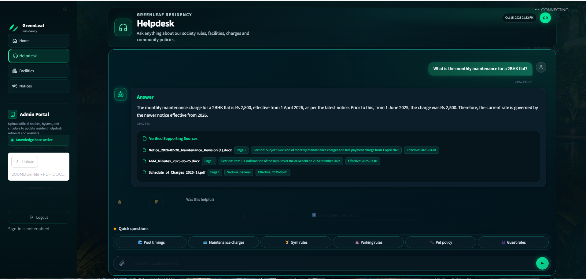
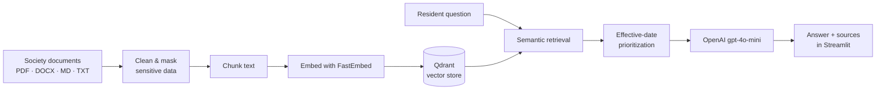

🌿 GreenLeaf Residency Helpdesk



---
Overview
Residential societies run on documents: bylaws, maintenance policies, amenity rules, and a steady stream of revised notices. Residents rarely read them, and committee members spend hours answering the same questions.
GreenLeaf Residency Helpdesk solves this with Retrieval-Augmented Generation (RAG). It finds the most relevant passages in the society's documents, generates a clear answer with the OpenAI API, and shows the exact sources behind every response, so residents can verify what they're told.
Why it matters
Challenge	How the Helpdesk addresses it
Residents can't find answers in long documents	Semantic search retrieves the right passage, even when wording differs
Policies change and older notices conflict	Effective-date handling prioritizes the most current policy
AI answers can't be trusted blindly	Every answer is shown with its supporting source documents
Documents contain personal information	Sensitive-data masking is applied during processing
Documents are updated often	Incremental indexing adds new notices without a full rebuild
---
Key Features
Multi-format ingestion: PDF, DOCX, Markdown, and TXT files
Text cleaning and sensitive-data masking applied before indexing
Semantic search with FastEmbed and ONNX Runtime
Local vector storage with Qdrant, so no external vector service is needed
Grounded answers generated by OpenAI `gpt-4o-mini`
Source attribution with document metadata on every answer
Effective-date handling to resolve conflicting policies
Incremental indexing for revised and newly issued notices
Clean Streamlit interface for residents
Automated tests covering the RAG pipeline and the UI
---
How It Works

Ingest: documents from `data/raw/` are loaded and cleaned, and sensitive data is masked.
Index: text is split into chunks, embedded, and stored in Qdrant.
Retrieve: a resident's question is embedded and matched against the most relevant chunks.
Answer: the retrieved context is passed to the language model, which writes a response grounded in those documents.
Cite: the app displays the answer alongside its supporting sources.
---
Technology Stack
Component	Technology
Language	Python 3.12
User interface	Streamlit
RAG framework	LangChain
Vector database	Qdrant (local)
Embeddings	FastEmbed (`sentence-transformers/all-MiniLM-L6-v2`)
Language model	OpenAI (`gpt-4o-mini`)
Document processing	PyPDF, Docx2txt
Testing	pytest, Streamlit AppTest
---
Project Structure
```text
greenleaf-residency-helpdesk/
├── data/
│   ├── raw/                 # Original society documents
│   ├── updates/             # Revised and new notices
│   └── processed/           # Generated cleaned documents and chunks
├── src/
│   ├── answer.py            # Answer generation
│   ├── build_index.py       # Initial index creation
│   ├── chunk_text.py        # Chunking and processed outputs
│   ├── clean_text.py        # Cleaning and sensitive-data masking
│   ├── config.py            # Configuration
│   ├── index_updates.py     # Incremental indexing of updates
│   ├── load_documents.py    # Multi-format document loading
│   └── retrieve.py          # Semantic retrieval
├── tests/
│   ├── test_rag.py
│   └── test_streamlit_app.py
├── app.py                   # Streamlit application
├── requirements.txt
├── README.md
├── RESULTS.md
└── .gitignore
```
---
Getting Started
Prerequisites
Python 3.12
An OpenAI API key
Internet access for the initial model download and OpenAI API calls
1. Clone the repository
```bash
git clone https://github.com/santhoshreddy0047-lgtm/Greenleaf-residency-helpdesk.git
cd Greenleaf-residency-helpdesk
```
2. Create a virtual environment
Windows (PowerShell)
```powershell
python -m venv .venv
.\.venv\Scripts\Activate.ps1
```
macOS / Linux
```bash
python -m venv .venv
source .venv/bin/activate
```
3. Install dependencies
```bash
python -m pip install -r requirements.txt
```
4. Configure your API key
Create a `.env` file in the project root:
```dotenv
OPENAI_API_KEY=your_openai_api_key_here
```
> ⚠️ Never commit your `.env` file or share your API key.
---
Usage
Build the document index
Place authorized source documents in `data/raw/`, then run:
```bash
python -m src.build_index
```
Index revised or new notices
Place updated documents in `data/updates/`, then run:
```bash
python -m src.index_updates
```
Generate cleaned documents and chunk outputs
```bash
python -m src.chunk_text
```
Launch the app
```bash
streamlit run app.py
```
Open the local address printed by Streamlit in your browser and start asking questions.
---
Testing
Run the mocked RAG and Streamlit tests:
```bash
python -m pytest tests/test_rag.py tests/test_streamlit_app.py -v
```
Recorded test results, functional question tests, update verification, privacy checks, and known limitations are documented in RESULTS.md.
---
Privacy and Security
API credentials are stored in `.env` and never committed.
`.env`, local vector database files, and generated processed data are excluded from Git.
The confidential complaint log is excluded from Git tracking.
Sensitive-data masking is applied during document processing.
Use only documents you are authorized to process and publish.
> **Note:** Masking is a safeguard, not a guarantee. It may not remove every personal detail, so review documents before indexing or sharing.
---
Known Limitations
Answer quality depends on document quality and retrieval relevance.
Some retrieved sources may not directly support every answer.
Privacy protection and source attribution require continued testing.
---
Roadmap
[ ] Retrieval-quality evaluation with a benchmark question set
[ ] Re-ranking to improve source relevance
[ ] Multi-language support for residents
[ ] Role-based access for committee-only documents
[ ] Containerized deployment
---
Author
Prajwal Naik
---
<p align="center">Built to make community living simpler, one answered question at a time. 🌿</p>
